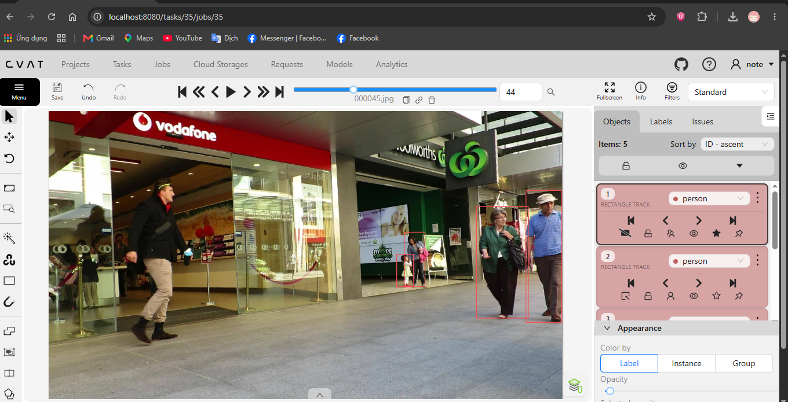
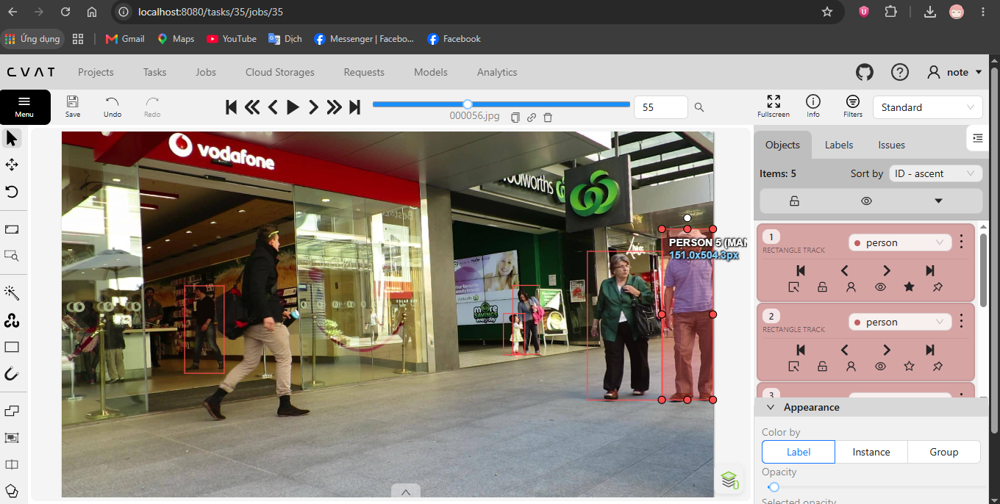

# Báo cáo cá nhân — HoVaTen-MSSV

Đổi tên file theo quy tắc `MSSV_HoTen.md`. Ví dụ: `20241234_NguyenVanAn.md`.

Đoạn video: MOT17-09, 150 frame (frame 1–150), nguồn MOTChallenge, giấy phép CC BY-NC-SA 3.0.

## 0. Thông tin học viên

- Họ tên: Nguyễn Ngọc Đồng
- MSSV: 2A202603291
- Mã đề (A/B/C):
- Email: csjbvhfff@gmail.com
- Link repository: https://github.com/IsMeNotee/K5-L2-DAY05-NguyenNgocDong-2A202603291-MOTTracking
- Giờ bắt đầu:17h
- Giờ kết thúc:18h

## 1. Xem trước đoạn video (CP0)

Ghi **trước khi vẽ**, mỗi người một dòng.

| Mã | Frame xuất hiện | Frame cuối thấy được | Rẽ / dừng / đổi tốc độ ở frame | Bị che ở frame | Ghi chú |
|---|---|---|---|---|---|
| P1 | 1 | 200 | di chuyển ra cửa | 33 | hết che frame 53 |
| P2 | 1 | 200 | đi thẳng | ko bị che | ko có |
| P3 | 1 | 106 | đứng im | 107 | ko di chuyển |
| P4 | 1 | 102 | đứng im | 103 | ko di chuyển |
| P5 | 37 | 200 | đi thẳng | ko bị che | ko có |

## 2. Keyframe và thời gian (CP1, CP4)

Số keyframe lấy từ kết quả `src/check_submission.py`.

| Mã | Số keyframe | Keyframe ở frame | Số frame có mặt | Keyframe / 100 frame | Thời gian (phút) | Chỗ khó |
|---|---|---|---|---|---|---|
| P1 | 22 | 0, 10, 18, 22, 29, 35, 38, 55, 63, 67, 71, 75, 83, 88, 92, 97, 114, 121, 128, 143, 146, 149 | 150 | 14.7 | 15 | Người di chuyển và có nhiều đoạn bị che |
| P2 | 30 | 0, 9, 18, 29, 38, 45, 48, 51, 58, 63, 67, 79, 83, 88, 92, 97, 101, 105, 111, 114, 118, 121, 124, 128, 132, 137, 140, 143, 146, 149 | 150 | 20.0 | 15 | Người di chuyển, bbox thay đổi vị trí và kích thước |
| P3 | 6 | 0, 9, 18, 22, 94, 105 | 150 | 4.0 | 15 | Đi gần P4, dễ xảy ra che khuất | Người nhỏ, dễ bị che bởi người khác |
| P4 | 8 | 0, 9, 18, 22, 38, 39, 105, 110 | 150 | 5.3 | 15 |
| P5 | 24 | 35, 42, 48, 58, 63, 67, 71, 79, 83, 88, 92, 97, 101, 105, 111, 118, 124, 128, 132, 137, 140, 143, 146, 149 | 115 | 20.9 | 15 | Người xuất hiện muộn, một phần cơ thể ở sát mép ảnh |

| **Tổng** | 90 | | 715 | 12.6 | 60 | |

Keyframe / 100 frame của cả bài = tổng keyframe ÷ tổng số frame có mặt × 100 = 90 ÷ 715 × 100 = 12.6

Bạn đặt keyframe nhiều nhất ở người nào? Vì sao (người đó rẽ, dừng, lại gần camera hay bị che)?

Tôi đặt nhiều keyframe nhất ở P2 với 30 keyframe. Người này di chuyển trong khung hình, khiến vị trí và kích thước bounding box thay đổi. Tôi bổ sung keyframe khi nội suy không còn bám sát người để cải thiện độ chính xác

## 3. Đoạn bị che (CP2)

Người bị che: `P1`

| Mốc | Frame |
|---|---:|
| Bắt đầu bị che một phần (bật `occluded`) | 33 |
| Mất hẳn (bật `outside`) | 40 |
| Hiện lại (tắt `outside`) | 53 |
| Thấy rõ trở lại (tắt `occluded`) | 57 |

- Thời gian khuất hẳn: 13 frame = 5 giây.
- Quyết định: giữ cùng ID
- Lý do (trả lời 3 câu: khuất bao lâu so với 60 frame, ngoại hình có khớp, chỗ hiện lại có đúng hướng và tốc độ):
+ Khuất 13 frame
+ Ngoại hình khớp
+ Gần như ko thay dodỏi hướng và tốc độ

Ảnh chụp màn hình:








## 4. Tự review ID (CP3)

Lượt 1 theo người (đi ngược từ frame 149 về 0 trên CVAT), lượt 2 theo cảnh (nhảy 10 frame). Ít nhất 3 dòng; không có lỗi thì ghi một dòng "đã kiểm hai lượt, không lỗi".

Loại lỗi dùng đúng một trong 7 mã: `id_switch`, `fragmentation`, `lost`, `merge`, `false_track`, `drift`, `flag`.

| Frame | Mã người | Loại lỗi | Mô tả một câu | Phát hiện ở lượt | Đã sửa? |
|---:|---|---|---|---|---|
| | | | | | |
| | | | | | |
| | | | | | |

Tổng hợp số lỗi theo loại:

| `id_switch` | `fragmentation` | `lost` | `merge` | `false_track` | `drift` | `flag` |
|---:|---:|---:|---:|---:|---:|---:|
| | | | | | | |

Lỗi nào chỉ lượt 2 (theo cảnh) mới thấy, lượt 1 (theo người) không thấy? Vì sao?

+ đã kiểm hai lượt, không lỗi

## 5. File xuất và kết quả tự kiểm (CP4)

| Kiểm tra | Kết quả |
|---|---|
| Tên file MOT 1.1 | NguyenNgocDong_mot.zip |
| Tên file CVAT for video 1.1 | NguyenNgocDong_cvat_video.zip |
| Số track ID khác nhau trong `gt/gt.txt` (phải là 5) | 5 |
| Frame `outside` không có dòng trong `gt.txt` (đúng / sai) | đúng |
| Job đã completed trên CVAT máy cá nhân | đúng |

Dán phần tóm tắt in ra từ `src/check_submission.py`:

```
=== File MOT 1.1: NguyenNgocDong_mot.zip ===
Số track ID: 5 | Tổng số box: 715
[OK] Đúng 5 track ID.

Track | Frame có mặt | Số frame | Đoạn vắng (outside)
1     | 0-149        | 150      | -
2     | 0-149        | 150      | -
3     | 0-149        | 150      | -
4     | 0-149        | 150      | -
5     | 35-149       | 115      | -

=== File CVAT for video 1.1: NguyenNgocDong_cvat_video.zip ===

Track | Frame thấy | Keyframe | KF/100 frame | Frame occluded | Lần bật outside
0     | 150        | 22       | 14.7         | 20             | 0
1     | 150        | 30       | 20.0         | 0              | 0
2     | 150        | 8        | 5.3          | 45             | 0
3     | 150        | 6        | 4.0          | 56             | 0
4     | 115        | 24       | 20.9         | 0              | 0

Tổng: 90 keyframe / 715 frame có mặt = 12.6 keyframe / 100 frame
[OK] Đọc được 5 track từ annotations.xml.

=== Tóm tắt ===
Lỗi: 0 | Cảnh báo: 0
Đạt. Dán phần tóm tắt này vào báo cáo mục 5.
```

## 6. Ba câu kết

1. Nếu được gán lại, bạn sẽ đặt keyframe khác ở đâu? Vì sao?

Tôi sẽ tập trung thêm keyframe tại các đoạn người thay đổi tốc độ, kích thước bounding box thay đổi nhanh và các đoạn bắt đầu hoặc kết thúc che khuất. Điều này giúp nội suy bám sát chuyển động hơn và giảm lỗi drift.

2. Có chỗ nào bạn không chắc "cùng ID hay ID mới"? Bạn đã quyết định và ghi chú thế nào?

Tôi gặp khó khăn với P3 vì người này xuất hiện ở vùng sát mép phải và một phần cơ thể có thể nằm ngoài ảnh. Ban đầu tôi tạo track ở frame 35, sau đó phải kiểm tra lại các frame trước và sau mốc nhận diện 40. Tôi giữ một track cho đúng người và loại bỏ track trống phát sinh trong quá trình chỉnh sửa.

3. Một lỗi ID trong job của bạn (nếu không còn sót, chọn lỗi đã sửa) có thể làm xe tự lái dự đoán sai chuyển động của người đó như thế nào? Lỗi đó ảnh hưởng MOTA hay IDF1 nhiều hơn?

Nếu một người bị tách thành hai ID khác nhau, hệ thống xe tự lái có thể hiểu nhầm họ là hai người độc lập, làm gián đoạn lịch sử chuyển động và dự đoán quỹ đạo. Lỗi này thường ảnh hưởng rõ đến IDF1 vì chỉ số này đánh giá tính nhất quán của danh tính theo thời gian. MOTA cũng có thể bị giảm do lỗi ID switch.

## Bonus (nếu làm)

### B1 — Hai người đi sát

Không thực hiện.

### B2 — So cách đặt keyframe

| Cách đặt | Số keyframe | Frame trôi nhất | Ghi chú |
|---|---:|---:|---|
| Đều mỗi 30 frame | | | |
| Theo chỗ đổi hướng | | | |

...

### B3 — So với tracker có sẵn

| Frame | Mã người | Tracker làm gì | Nhãn của bạn | Giải thích (đoán rồi sửa / ghép IoU / box score thấp / ngoại hình) |
|---:|---|---|---|---|
| | | | | |
| | | | | |

## 7. Tài liệu tham khảo và công cụ AI đã dùng

...
